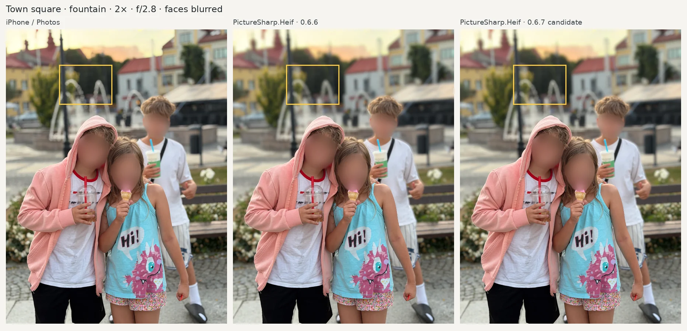
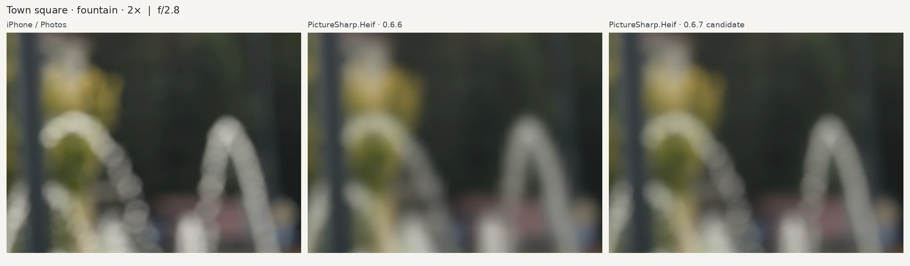
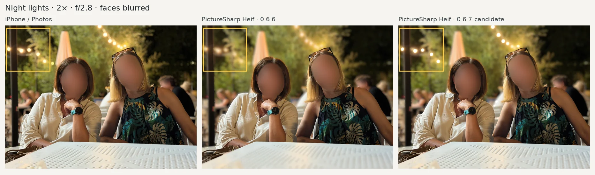
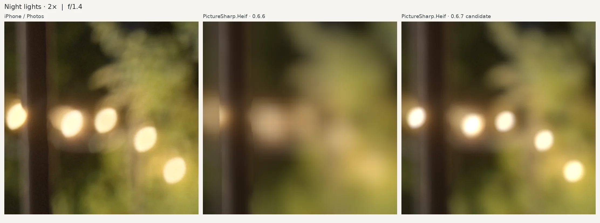
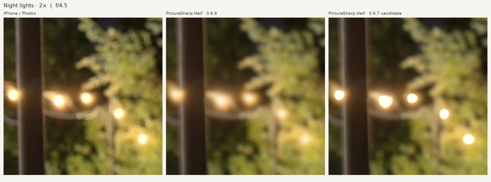
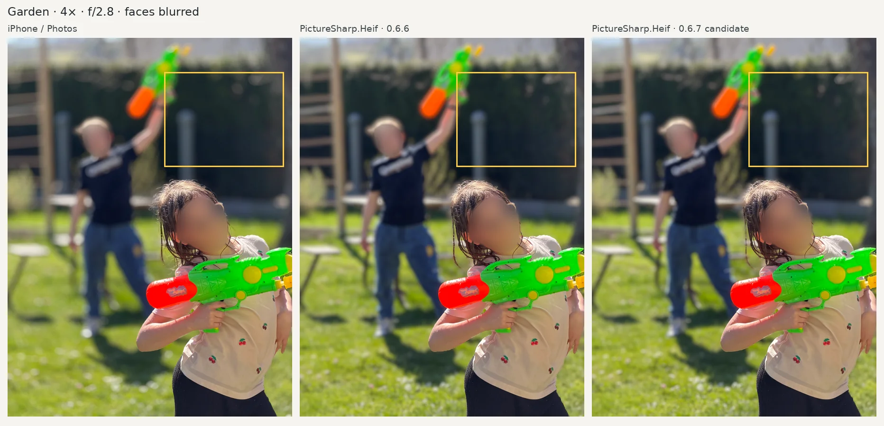
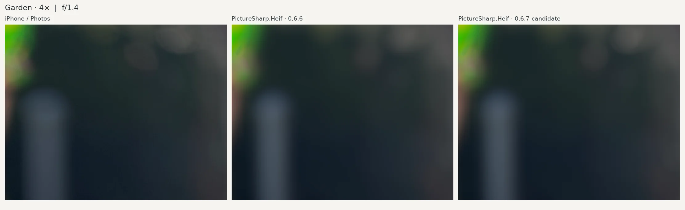
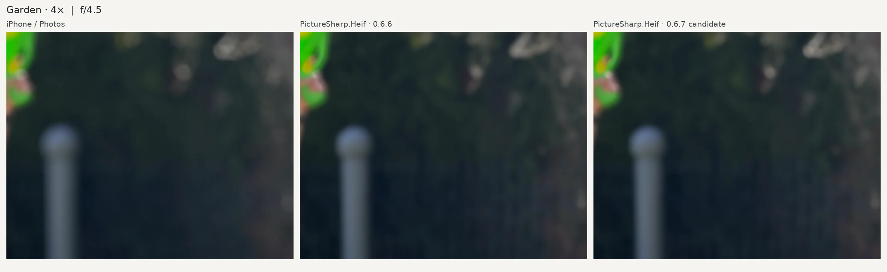

# PictureSharp.Heif 0.6.7 — portraits, light, and bokeh: details

The detailed release notes with the comparison gallery. A short summary is in [release-0.6.7.md](release-0.6.7.md).

**Release date: October 20, 2026.**

Version 0.6.7 improves portrait rendering: what stays in focus, the transition around hair and outlines, how much blur falls on objects in front of the subject, and the shape of the discs produced by out-of-focus lights. Fountain droplets, sunlit foliage, and lamps at night make these changes visible; a uniform background blur is not enough for any of them. Rendering is also several times faster and gives the same pixels on every machine.

PictureSharp.Heif uses the image, depth data, and available portrait matte stored in the HEIC file. Rendering runs in C#, without native libraries. The existing API still lets you set a simulated aperture and choose a focus point; this update adds no public options or dependencies.

Requires .NET 10 and PictureSharp 0.7.6 or later. The public API is unchanged.

## Gallery: the same crop and aperture

Every illustration has three columns: **an iPhone Photos export on the left, the PictureSharp.Heif 0.6.6 renderer in the middle, and the 0.6.7 candidate on the right**. Both library renders use the same original HEIC. Each comparison uses the same aperture, crop, and scale.

The apertures **f/1.4, f/2.8, f/4.5, f/8, and f/16** are settings of the simulated portrait effect. Each series contains exports of one photograph, not five exposures taken with different physical apertures. All series shown here use the default focus.

Faces are blurred using individually fitted contours with soft edges. The masks follow the faces while leaving the surrounding hair, clothing, and background visible. The yellow outline in the scene overviews marks the detail crop. The same privacy masks are applied to all three columns; masked areas are excluded from visual assessment of the renderer.

### Town square: fountain droplets as points of light

Bright droplets against a darker background are a useful test of bokeh. In the new renderer, point highlights produce their own blur discs with more defined edges. The brightest points receive a limited boost so that they are less likely to disappear into a smooth background. This does not brighten the entire photograph.

**What to look for:** the size and definition of bright discs, the appearance of the water jets, and the droplets against dark trees. Lower f-numbers should produce stronger blur; closing the simulated aperture brings back more background detail. In the f/2.8 crop, the iPhone still separates individual droplet discs more clearly, while PictureSharp produces a smoother transition. The improved model does not yet reproduce this effect fully.

[Full fountain series: f/1.4 → f/16](images/0.6.7/rynek_2x-series.webp)

### Night lights: disc brightness and shape

Night lamps need separate treatment. Their clipped cores contain too little information for ordinary averaging to preserve the appearance of a bright light source. The new renderer detects these clusters behind the focus plane and boosts their contribution to bokeh. It distinguishes them from large bright surfaces, so that the umbrella and foliage do not receive the same treatment.

Near the edges of the frame, discs can take on a “cat’s-eye” shape: they become oval and align tangentially around the image centre. The new model includes this behaviour.

**What to look for:** the brightness and colour of the lamps, the oval shape of discs near the frame edge, and their separation from the surrounding foliage. A known difference remains at f/1.4: PictureSharp’s discs can be smaller and softer than those in the iPhone export. The night model still needs validation on additional scenes.

[Full night-light series: f/1.4 → f/16](images/0.6.7/swiatla_2x-series.webp)

### Garden: foliage and gradual changes in the background

The garden presents another challenging background: small leaves, gaps, and contrasting edges. The amount of blur matters, but so does a consistent change in background structure across apertures. The crop covers foliage and fencing on the right, away from faces.

**What to look for:** foreground/background separation, the size of blurred shapes, and the return of fine texture at f/8 and f/16. This scene also illustrates a limitation: in the E5 measurements, the garden background at f/4.5 scored 0.46 dB below the frozen baseline. An improvement across the dataset does not mean that every photograph improves.

[Full garden series: f/1.4 → f/16](images/0.6.7/ogrod_4x-series.webp)

## Portrait changes

- **A focus range instead of a single default plane.** Automatic focus covers a larger part of the subject’s depth range, helping its nearer parts stay sharp. An explicit `FocusPoint` still selects a single plane.
- **Better transitions around outlines and hair.** Separating subject and background depth near the matte boundary, and reducing background contamination in strands, improves the transition between a sharp subject and a blurred background.
- **Less aggressive foreground blur.** At wide simulated apertures, objects in front of the focus plane receive less blur. Object portraits without a person matte also have an additional zone that delays the onset of foreground blur.
- **Point lights and night lamps.** Bright points produce defined discs; clipped lamps in night shots are scattered as brighter, cat’s-eye discs near the frame edges.
- **A correction for large blur radii in 2× images.** At strong blur settings, the radius grows more slowly, improving agreement with the tested exports.
- **Subtle texture in blurred areas.** Grain strength depends on ISO. It is not added to in-focus areas and does not attempt to reproduce the export’s particular noise pattern or compression blocks.

Details and rationale: [focus range](../measurements/portrait-0.6.7-focus-range.md), [edges and hair](../measurements/portrait-0.6.7-edges.md), and [bokeh and foreground](../measurements/portrait-0.6.7-bokeh.md).

## Speed and the same pixels everywhere

| Render (IMG_6986, resized) | Before optimization, 1 / all threads | 0.6.7, 1 / all threads |
| --- | ---: | ---: |
| 12 MP, f/1.4 | 6071 / 3370 ms | 2525 / 413 ms |
| 24 MP, f/1.4 | 16315 / 10723 ms | 6134 / 878 ms |
| 48 MP, f/1.4 | 43387 / 32065 ms | 16367 / 2167 ms |

A render takes 2.2–3.1× less time on one thread and 2–15× less with all threads, and allocates 30–60 % less in most cases. Lights are detected and scattered in parallel, disc rows and layer building use SIMD, and temporary buffers come from `ArrayPool`, also returned on cancellation and error. Peak memory stays within −3…+7 %, except night scenes (+11–19 %).

A render no longer depends on the CPU: x64 with or without FMA, Native AOT and ARM64 give bit-identical results, as before for any thread count. `Vector3/Vector4.Lerp`, which fuse to a multiply-add on CPUs with FMA, and `MathF.Pow` in the radius formula were replaced by separately rounded operations. The change moves pixels by rounding amounts only.

Details: [performance and validation](../measurements/portrait-0.6.7-engineering.md).

## Measurement results

The main dataset contains **15 originals and 66 exports**. After separating edited photographs and low-light foliage test scenes, the main quality summary covers **10 scenes and 52 pairs**. Another 12 pairs from two iPhone 13 Pro scenes were validated separately; the main dataset comes from an iPhone 17 Pro.

The following results describe the completed E5 stage against the frozen 0.6.6 renderer. Versions 0.6.5 and 0.6.6 shared the previous rendering model.

| Region | PSNR change against baseline |
| --- | ---: |
| Background | +1.07 dB |
| Subject / object | +3.82 dB |
| Edges | +1.67 dB |
| Hair | +1.36 dB |
| In-focus patch | +5.17 dB |

PSNR measures pixel agreement with the iPhone export; a higher value means less error. Measurements use fixed tonal normalization for each pair and equal weighting of scenes. **The gallery does not apply this normalization**: it shows images converted to sRGB using their colour profiles. Differences in brightness in the illustrations should therefore not be interpreted solely as differences in bokeh.

The metric for the brightest background areas increased from **22.68 to 24.71 dB** between E4 and E5. A subsequent object-portrait correction improved the subject score by another 0.475 dB, reaching approximately **+4.30 dB against baseline**. Aggregate results do not describe the quality of every individual crop.

Sources: [E5 report](../measurements/portrait-0.6.7-bokeh.md), [results after the object-portrait correction](../measurements/portrait-0.6.7-object-front-summary.tsv), and [methodology and baseline](../measurements/portrait-0.6.7.md).

## Validation

The full 66-pair regression check passed with the previously accepted exceptions for edge and hair bands at f/8–f/16 and the edge region of the bathing scene at f/4.5. The final validation on October 20, 2026:

- x64, outside the Local category: **731 passed, 0 failed, 10 skipped** (opt-in measurement tools); Oracle tests pass.
- Local category: **12/12**, including the 66-pair gate and the 12 separately validated pairs.
- ARM64: **719 passed, 0 failed, 21 skipped**; the 10 Oracle tests are skipped there because the reference tools are not installed.
- A Native AOT consumer of the package published without trim or AOT warnings and rendered the same pixels.

Reported gaps: no Oracle run on ARM64, and Native AOT checked only for linux-x64. Skipped tests are not counted as passes. See the [validation report](../measurements/portrait-0.6.7-engineering.md#e7-validation).

## Known limitations

- Six region/pair combinations where the subject or in-focus patch still scores worse than the unblurred image: the deckchair, post, swimming-pool scene, and a marginal refocus case in the town square.
- Strands behind the head in the bathing scene.
- Additional night photographs are needed to test how well the lamp model generalizes.
- The per-pixel gather between blur layers remains on `System.Numerics.Vector4` without explicit 256-bit SIMD.
- The validation photographs of an iPhone 13 Pro carry an Apple gain map without the MakerNote headroom, and newer Photos exports carry only an ISO 21496-1 map in a colour space other than sRGB or Display P3; both are reported as unsupported HDR (`HdrInfo.CanDecode` false), not decoded.

Support for `.AAE` edits, Photographic Styles, and writing the effect or depth data to HEIC remains outside this description. We do not claim identical output to Apple’s renderer.

## How the illustrations were prepared

All comparisons were rendered at the photographs’ native resolution. The 0.6.6 column uses the frozen renderer from tag `v0.6.6` (commit `f22ee6ea1672059df7bedb2160b67515c12cf419`); the SHA-256 hashes of all four frozen source files were verified before rendering. The 0.6.7 column (labelled “candidate” in the images) was rendered after E5; the later rounding change (separately rounded `Lerp`) moves the metrics by at most 3.4·10⁻⁵ dB and does not change the comparison.

Both versions receive image pixels, depth, and matte data loaded by the current decoder. This isolates the portrait renderer change rather than comparing the complete decoding stacks. The reference is the primary image stored in the iPhone HEIC export. Gain maps are not loaded: this is an SDR comparison, not a reproduction of HDR presentation on a phone screen.

All three images are converted from their embedded ICC profiles to sRGB. Individually fitted, softly feathered face masks are then applied at the same coordinates in all columns, followed by identical cropping and scaling. The masks follow visible face contours, including faces in profile and small faces in the background, rather than covering large rectangular areas. They preserve surrounding details needed to assess hair and subject boundaries; the blurred facial areas themselves are not suitable for quality assessment.

No generative retouching, sharpening, or colour matching to the competing output was used. Illustrations are saved as **WebP at quality 85**, with the sRGB profile and without EXIF or XMP. Lossy compression can change fine texture, so these illustrations support visual comparison; the metrics come from the measurements.

The published illustrations contain only anonymized comparisons. Original photographs, unredacted renders, and private reproduction records remain outside the repository.
