# PictureSharp.Heif 0.6.8 — Photos adjustment sliders: details

The detailed release notes with the comparison gallery. A short summary is in [release-0.6.8.md](release-0.6.8.md).

**Release date: October 20, 2026.**

Version 0.6.8 adds `HeifPhotosEdit`, which re-applies the sliders of Apple Photos' "Adjust" panel to a decoded
photograph. Photos keeps such edits in its library: the original HEIC carries no slider values, and the iOS 27
`.AAE` sidecar holds only the portrait effect. A program that converts the original therefore loses the look the
user chose. With 0.6.8 the application passes the slider values it knows (from its own UI, a catalogue or a note)
and gets a picture close to what Photos exports.

Rendering runs in C#, without native libraries, and gives the same pixels for any thread count. Requires .NET 10 and
PictureSharp 0.7.6 or later.

## Using the API

```csharp
var options = new DecoderOptions { Configuration = ImageConfiguration.Default.ToBuilder().AddFormat(new HeifFormat()).Build() };
using Image photo = Image.Load("IMG_8113.HEIC", options);

// One slider, as shown in Photos.
using Image warmer = HeifPhotosEdit.Render(photo, new HeifPhotosAdjustments { Warmth = 50 });

// A recipe of several sliders; records are immutable, so variants are cheap to derive.
var recipe = new HeifPhotosAdjustments { Warmth = 40, Vibrance = 30, Contrast = 20, Vignette = 30 };
using Image look = HeifPhotosEdit.Render(photo, recipe);
using Image mono = HeifPhotosEdit.Render(photo, recipe with { Saturation = -100, Warmth = 0, Vibrance = 0 });

// Limit the threads and allow cancellation, e.g. in a server.
using var timeout = new CancellationTokenSource(TimeSpan.FromSeconds(5));
using Image result = HeifPhotosEdit.Render(photo, recipe with { MaxDegreeOfParallelism = 2 }, timeout.Token);
result.SaveAsHeic("IMG_8113-edited.heic");
```

The sliders, their ranges and how closely each matches Photos are listed in the
[decoding guide](../decoding.md#photos-adjustments). 0 leaves a slider off, values outside the range throw
`ArgumentOutOfRangeException`, and metadata and alpha are kept; an attached HDR gain map is removed.

## Gallery: Photos export next to PictureSharp.Heif

Each comparison has three columns: **the original, the Photos export with one slider set, and the PictureSharp.Heif
render of the original with the same slider**. Below each image is the difference from the Photos export, first of
the unedited original and then of the render (RMS of 8×8 block means in 8-bit levels; lower is better). Two exports
of the same edit differ by about 0.8 on this scale.

The sliders were fitted to these photographs, so the gallery shows how the model behaves, not how it generalises;
held-out errors are in the [measurements](../measurements/photos-edits-0.6.8-fit.md).

### Warmth +50

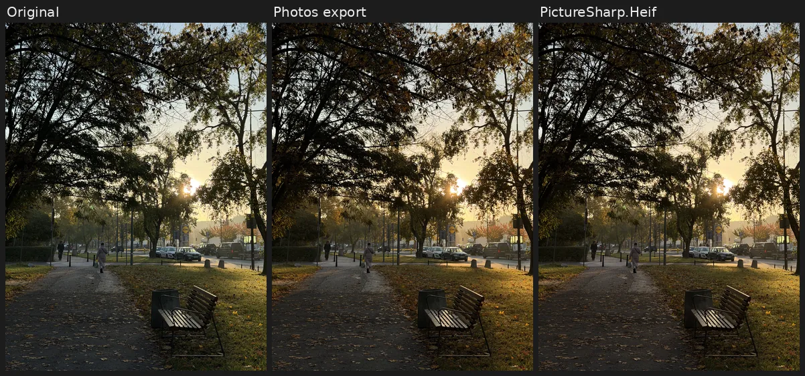

Original 5.20 → render 1.98. The white-balance shift is global and the same in every part of the picture, which makes
warmth and tint the easiest sliders.

### Vignette +50

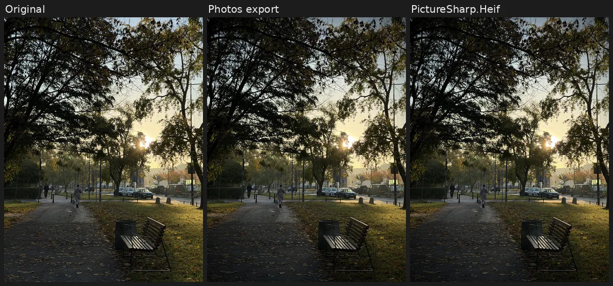

Original 11.16 → render 1.03. Photos darkens the corners in linear light with a circular falloff that starts at about
55 % of the half-diagonal and leaves the centre untouched. Negative values brighten the corners less strongly than
positive values darken them; the model follows the measured asymmetry.

### Saturation −100

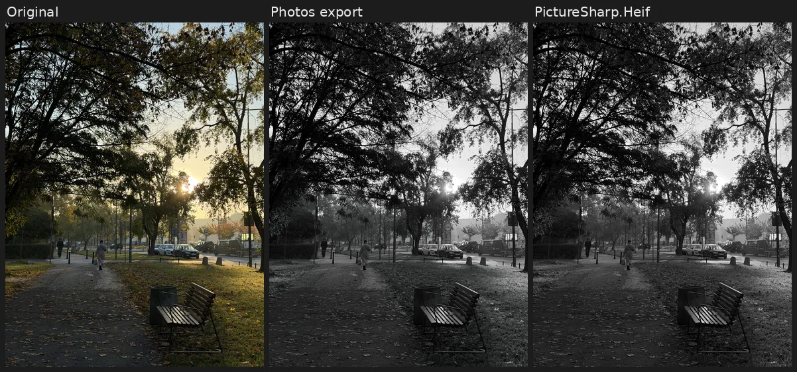

Original 11.77 → render 2.05. −100 removes the colour completely; smaller values scale it, a little less for colours
that are already saturated.

### Black point −50

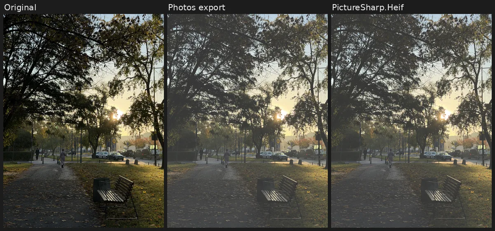

Original 31.38 → render 1.41. Negative values lift the blacks, positive values crush dark tones to black.

### Brightness +50 and contrast −50

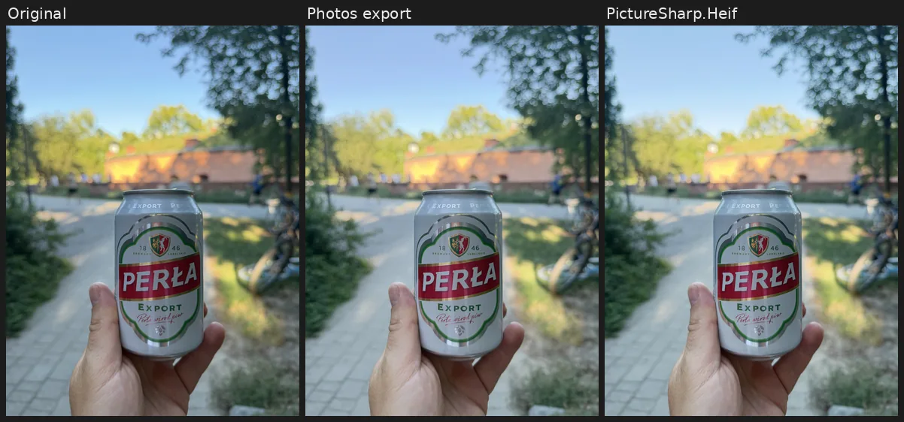

Brightness: original 16.50 → render 4.13.

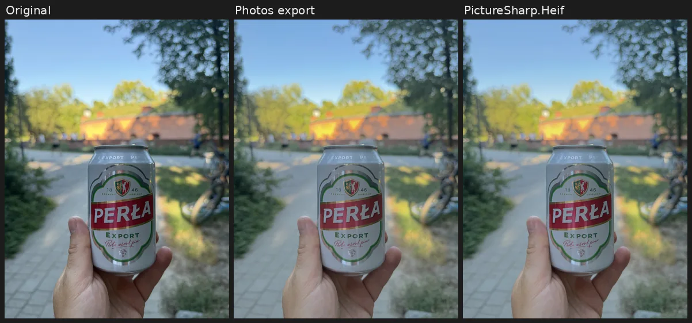

Contrast: original 13.12 → render 2.91. Brightness and contrast curves fitted on one scene also work on the others
(sunset, night and daylight), so they are the most reliable tone sliders.

### A limitation: exposure −50

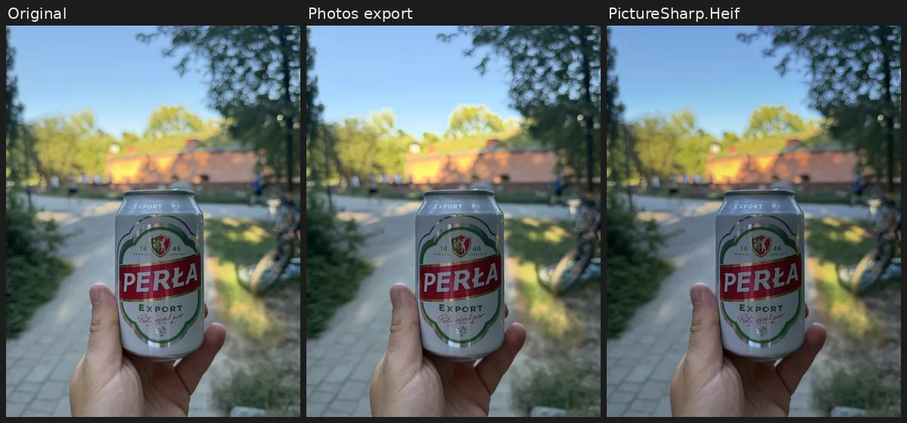

Original 8.88 → render **16.08**: here the render is farther from Photos than the unedited photograph. Photos adapts
exposure to the picture. In the daylight scene −50 barely darkens it, while the sunset and night scenes darken
strongly, and small positive values even protect the highlights there. One averaged curve cannot follow that. Exposure
is the main target of the next version.

## Recipes: what to set for a goal

The sliders work like those in Photos, so the usual editing habits apply. Each recipe is a starting point, shown on a
photograph that was not used for fitting; adjust the values to taste. Only the slider values change between the
recipes:

```csharp
using Image photo = Image.Load("IMG_3928.HEIC", options);
var details = new HeifPhotosAdjustments { Definition = 60, Sharpness = 40, Contrast = 15, Brilliance = 20 };
using Image result = HeifPhotosEdit.Render(photo, details);
```

### Brighten a backlit photo

`Shadows = 60, Brightness = 30, Highlights = -30, Vibrance = 15`

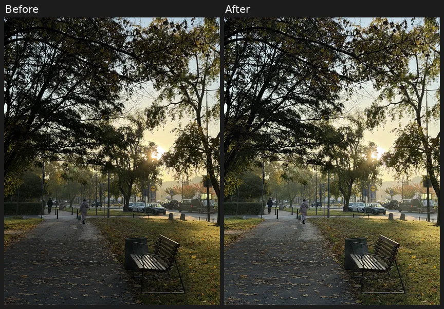

Shadows and brightness open the dark trees and the path, negative highlights keep the sky around the sun from
washing out, and a little vibrance restores the colour that lifting shadows takes away. Exposure would brighten the
sky as well, and it is the least reliable slider in 0.6.8.

### Lift the shadows of a shaded scene

`Shadows = 50, Brilliance = 30, Brightness = 10, Warmth = 10`

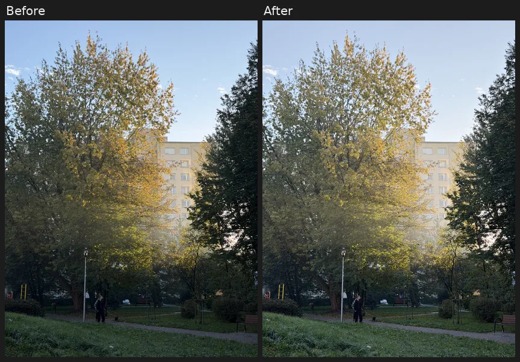

Brilliance adds local contrast while it brightens, so the lifted foliage does not turn flat; a touch of warmth
counters the blue cast of shade.

### Bring out detail

`Definition = 60, Sharpness = 40, Contrast = 15, Brilliance = 20`

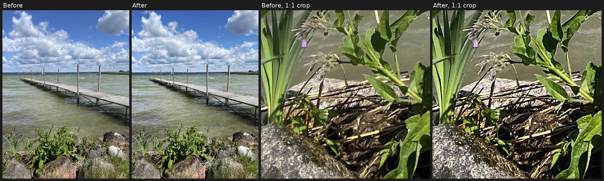

Definition raises local contrast at medium scales (texture of stones, clouds), sharpness the finest edges; the 1:1
crops on the right show the difference that is hard to see in the whole frame. Sharpness above 50 starts to outline
edges with halos.

### Deepen the sky

`Highlights = -60, Contrast = 10, Vibrance = 25`

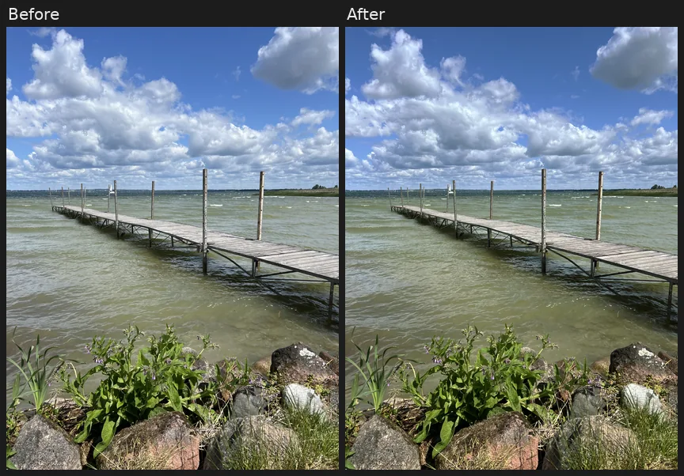

Negative highlights tone down the bright clouds, vibrance strengthens the blue without making the green water garish.
The effect is modest: highlights is one of the approximate sliders and Photos recovers more in strongly lit skies.

### Autumn warmth

`Warmth = 35, Vibrance = 40, Saturation = 10, Vignette = 25`

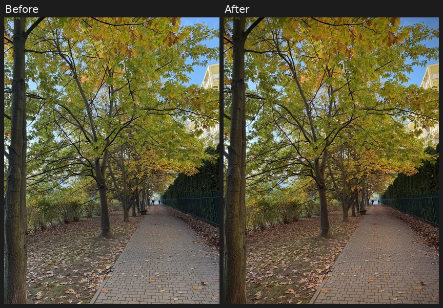

Warmth and vibrance strengthen the yellow leaves; the vignette darkens the corners and draws the eye along the path.

### Black and white

`Saturation = -100, Contrast = 35, Definition = 40, BlackPoint = 10`

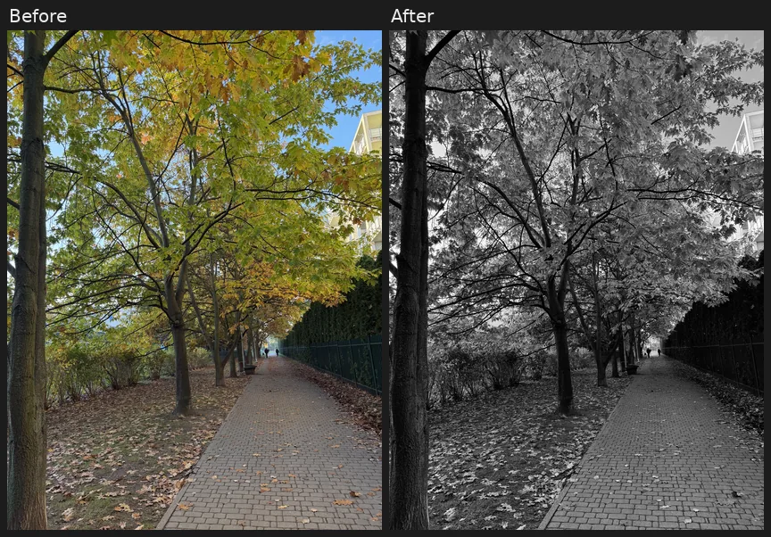

Without colour the picture needs contrast and texture to hold together: contrast and a slightly raised black point
deepen the darks, definition brings out the bark and the paving.

### Soft matte look

`Contrast = -30, BlackPoint = -40, Saturation = -15, Warmth = 15`

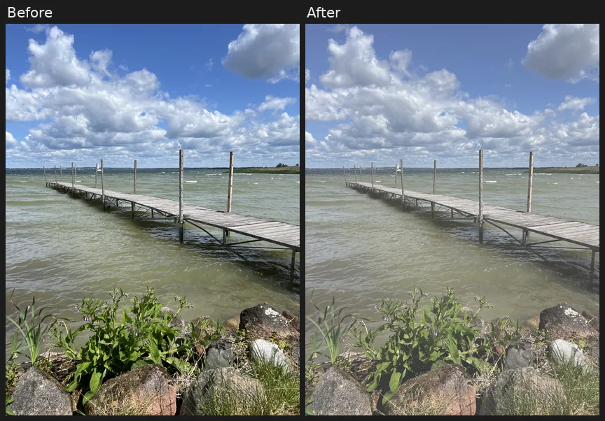

Negative black point lifts the blacks to a faded grey, negative contrast and saturation soften the picture, and
warmth gives it a film-like tone.

## Gallery: more combinations

Two more photographs not used for fitting, each with two recipes. There are no Photos exports of these
combinations, so they show only the character of the results; sliders combine in the fixed order described in the
[guide](../decoding.md#photos-adjustments), which has not been compared with Photos.

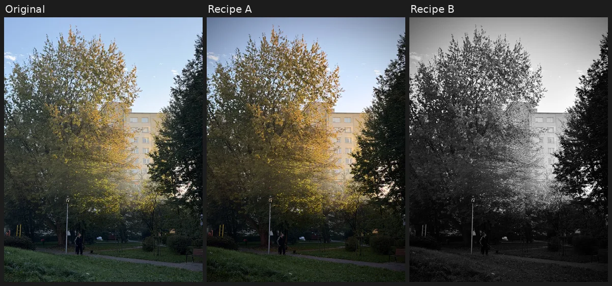

**Recipe A**: `Warmth = 40, Vibrance = 30, Contrast = 20, Vignette = 30`, a warmer evening look.
**Recipe B**: `Saturation = −100, Contrast = 40, Definition = 50, Vignette = 40`, black and white with local contrast.

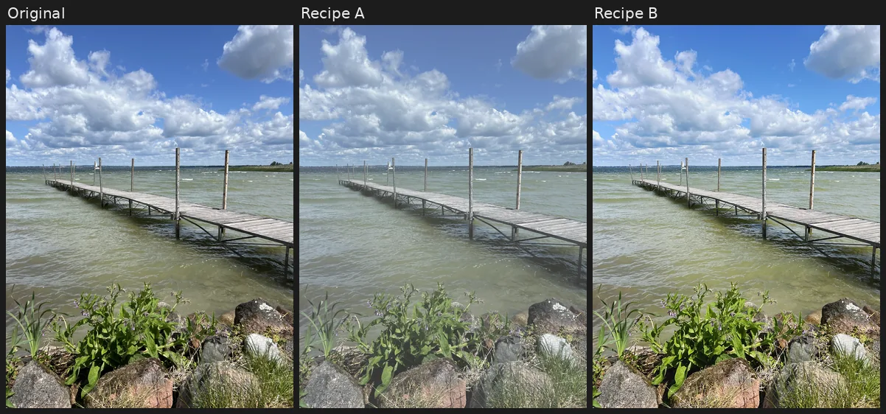

**Recipe A**: `Warmth = −30, Contrast = −40, BlackPoint = −30, Saturation = −20`, a cool matte look.
**Recipe B**: `Brilliance = 50, Saturation = 30, Sharpness = 40`, vivid and crisp.

## How the sliders were fitted

Three iPhone photographs (a sunset street, a night scene with street lights and a daylight scene) were exported from
Photos 94 times, one slider at a time, at ±25/±50/±100 (25/50/100 for the 0…100 sliders). The values were annotated
by hand in `edits.tsv`. For every slider several models were compared by a spatial holdout. The measurements showed:

- **Tone sliders act per channel on sRGB values.** Exposure, brightness, shadows, highlights and black point are
  curves per channel, not luminance-preserving gains; contrast is a curve on luma.
- **Colour sliders act on chroma.** Saturation and vibrance scale the distance from grey, keyed by how saturated a colour is.
- **Vignette is a radial gain in linear light.**
- **Detail sliders are band filters.** Sharpness, definition and noise reduction, and the local part of brilliance and
  shadows, are gains of Gaussian bands from 1 to 128 px.

Values between measured slider positions are interpolated; parameters of the scenes are averaged. Each prediction was
also checked against slider values and scenes left out of the fit: brightness and contrast transfer between scenes,
exposure and highlights do not. The full analysis, residuals per pair and confidence levels are in
[photos-edits-0.6.8-fit.md](../measurements/photos-edits-0.6.8-fit.md).

## Speed

| Photo | Tone and colour sliders | All sliders (with band filters) |
| --- | ---: | ---: |
| 2 MP | 0.03 s | 0.2 s |
| 12 MP | 0.2 s | 1 s |
| 24 MP | 0.35 s | 1.9 s |

i5-12500H, all threads. The band filters are scalar in 0.6.8; SIMD is planned.

## Validation

Synthetic tests check the identity, the ranges, the direction of each slider, alpha, cancellation and that the result
does not depend on the thread count. A local test renders all 94 annotated exports at up to 2 MP (18 s): warmth, tint,
vignette, brightness and contrast are closer to Photos than the unedited photograph on every pair; overall 86 of 94
pairs are, the exceptions being seven exposure pairs and noise reduction.

## Known limitations

- Exposure, highlights, brilliance and shadows adapt to the scene in Photos and are only approximated; exposure can be
  farther from Photos than the original.
- Sharpness and noise reduction in Photos are edge-adaptive; the linear band filter is a first approximation.
- Combined sliders use a fixed order that has not been measured.
- Photos filters (presets), crop, straighten, Clean Up and Portrait Lighting are not supported.
- No identity with Photos is claimed; the fit covers three scenes from one iPhone.
